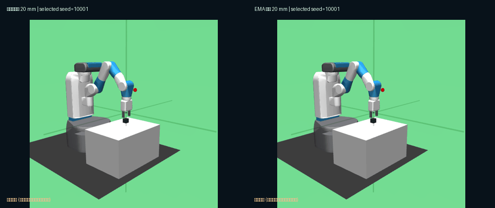

# MuJoCo 机械臂抓放仿真对照演示与一致性核查 · 2026-11-01

## 演示目的与实验数据

在 20 mm 位置观测噪声下，展示**相同初始随机种子、相同第三方 SAC 预训练模型**的两种策略行为：

- 初始环境随机种子：10001。
- 未滤波策略：50 步，**曾达成目标 = 否，终态成功 = 否**。
- EMA 位置滤波策略：50 步，**曾达成目标 = 是，终态成功 = 是**（首次成功步数为 37）。
- 录制成果：50 帧、1000 × 420 像素、左右同步对照 GIF。
- 模型权重 SHA-256：1aad52960bc0b7baaa5249f3aa1a2de09009c300dd2b0bf61c9c51d7467b017b。
- GIF 与逐案例 JSON 已归档在公开仓库：assets/demo.gif、assets/demo.json、assets/model_provenance.json。公开仓库中的[仿真演示工作流](./.github/workflows/demo.yml)可以重新生成该演示。

## 一项必要的技术修复

第一次录制时，直接在被测环境中调用 env.render()，导致该随机种子的录制结果与批量评估结果不一致。因此，第一次视频没有被用作证据。

修复方法是：**分别创建无渲染的被测环境，以及仅用于画面采集的展示环境。** 在被测环境中执行动作后，将位置、速度、动捕状态和时间等 MuJoCo 状态复制到展示环境；只在展示环境中调用 mj_forward() 与 render()，避免绘图过程改变被测物理轨迹。

重新录制后，结果与 30 种子批量评估中的随机种子 10001 一致：未滤波策略最终失败，EMA 策略最终成功。额外增加了 --expect-contrast 检查；如果该案例不满足预期的真实成功/失败条件，脚本会拒绝生成可用于展示的对照演示。

## 解释边界

该案例是**事后有意识挑选的反差案例**，不是随机抽样、平均轨迹或总体提升幅度。总体结论必须以 [210 回合独立评估报告](./EVAL30_REPORT_2026-11-01.md) 和原始 CSV 为依据。

GIF 展示的是 MuJoCo 仿真，不是实体机械臂录像。模型权重由 [hhmm1122](https://huggingface.co/hhmm1122/fetch-pickandplace-sac-her) 提供；本项目新增的是实验设计、对照评估、结果分析与录制流程。
