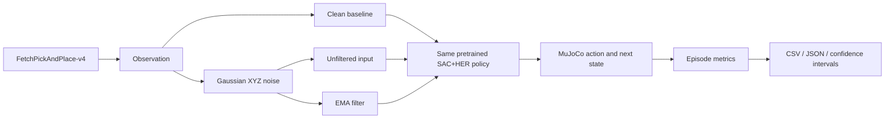

# SAC + HER Robotic Manipulation: Robustness to Noisy Position Observations

**A reproducible MuJoCo evaluation study of how Gaussian position-observation noise and exponential moving-average (EMA) filtering affect a pretrained FetchPickAndPlace policy.**

[Experiment report](./EVAL30_REPORT_2026-11-01.md) · [Demo validation](./DEMO_REPORT_2026-11-01.md) · [Resume case study](./RESUME_CASE_STUDY.md) · [Technical notes](./TECHNICAL_NOTES.md)

> **Scope and ownership.** This project does not train a new SAC+HER policy. It evaluates one third-party pretrained checkpoint and contributes the observation-noise injection, EMA comparison, paired-seed evaluation, diagnostics, plotting, reproducibility workflow and analysis. All results below are MuJoCo simulation results, not real-robot results.

---

## Key result

At **20 mm Gaussian position-observation noise**, EMA filtering increased final-success rate from **33.3% (10/30)** to **76.7% (23/30)** on the evaluated checkpoint. At 5 mm and 10 mm, EMA reduced final-success rate by 16.7 percentage points. The result is therefore a **noise-dependent trade-off**, not a universal improvement.


### Independent evaluation · 30 environment seeds per condition

| Position-noise σ | Unfiltered policy: ever / final | EMA policy: ever / final |
|---:|---:|---:|
| 0 mm (clean) | 100.0% / 100.0% | — |
| 5 mm | 100.0% / 100.0% | 90.0% / 83.3% |
| 10 mm | 100.0% / 93.3% | 96.7% / 76.7% |
| 20 mm | 80.0% / 33.3% | 86.7% / 76.7% |

- **210 episodes** in the independent evaluation: 7 conditions × 30 environment seeds (10000–10029).
- **245 episodes total** across the 35-episode pilot and the independent 210-episode evaluation. The pilot and main evaluation use different seed ranges.
- **Final success** means the task is successful at the final step. **Ever success** means the task reached the success condition at least once during the episode. They are not interchangeable.
- At 20 mm, paired outcomes were: EMA-only success 14, unfiltered-only success 1, both success 9, both failure 6. Exploratory exact two-sided McNemar p = 0.0009766; no multiplicity correction was applied.
- Wilson intervals are wide enough to matter. For example, the 23/30 EMA result at 20 mm has a 95% Wilson interval of approximately 59.1%–88.2%.

**Interpretation:** EMA may suppress larger measurement fluctuations, but its lag may hurt control at lower noise levels. The lag explanation is a hypothesis, not yet a verified causal mechanism.

## What was built

1. **Observation perturbation.** Inject independent Gaussian noise into gripper and object XYZ observations.
2. **Goal consistency.** Recompute relative position and update `achieved_goal` from the perturbed object position, avoiding a clean-state information leak. Keep `desired_goal` unchanged.
3. **Filtering baseline.** Compare the unfiltered observation against EMA-filtered observations using the same fixed policy and matched initial environment seeds.
4. **Evaluation contract.** Record both ever-success and final-success, first-success step, episode return and diagnostic distances.
5. **Reproducible evidence.** Pin the model revision and SHA-256, pin runtime dependencies, run tests and evaluation in GitHub Actions, and export CSV, JSON and figures.
6. **Paired analysis.** Compare binary outcomes on matched initial seeds and calculate an exploratory exact McNemar test.

## Experiment flow



## Demo

A cloud-rendered, side-by-side MuJoCo GIF was generated for one deliberately selected contrast case: seed 10001 at 20 mm noise. The unfiltered episode ended unsuccessfully; the EMA episode reached success at step 37 and ended successfully.

- [Demo outcome and rendering-fidelity report](./DEMO_REPORT_2026-11-01.md)


- [Download the selected-seed GIF](./assets/demo.gif) · [Demo manifest](./assets/demo.json) · [Demo validation report](./DEMO_REPORT_2026-11-01.md)
- The selected GIF is a **single illustrative case**, not a representative sample. Overall performance must be judged from the 210-episode evaluation above.
- The GIF is generated by the public repository's [demo workflow](./.github/workflows/demo.yml); it is not a real-robot recording.

The standalone HTML dashboard source is [`index.html`](./index.html). Download it and open it locally in a browser; a public GitHub Pages deployment has not yet been configured.

## Public raw evidence

The exact per-episode records and aggregate JSON used for the 30-seed report are committed in this repository:

- [`evidence/episodes.csv`](./evidence/episodes.csv.gz) — all 210 measured episodes.
- [`evidence/summary.json`](./evidence/summary.json) — seven condition-level summaries and confidence intervals.
- [`evidence/model_provenance.json`](./evidence/model_provenance.json) — upstream checkpoint revision and SHA-256.
- [`evidence/README.md`](./evidence/README.md) — evidence origin, definitions and integrity notes.

The public [Actions page](https://github.com/ELIMS-ECHO/mujoco-robustness-portfolio/actions) contains this repository's CI and future reproducibility runs.

## My contribution vs. upstream work

| Component | Attribution |
|---|---|
| SAC + HER policy training and checkpoint | Third-party model by [hhmm1122](https://huggingface.co/hhmm1122/fetch-pickandplace-sac-her); not my training result |
| Noise injection and goal-consistent observation transformation | Implemented in this project |
| EMA filtering and matched-seed evaluation | Implemented in this project |
| Episode metrics, CSV/JSON output, confidence intervals and paired analysis | Implemented in this project |
| Plotting, regression tests, Windows runner and GitHub Actions workflows | Implemented in this project |
| Real-robot deployment or sim-to-real transfer | Not completed |

## Reproduce

### Requirements

- Python 3.11
- MuJoCo 3.3.7
- Gymnasium 1.2.3 and Gymnasium-Robotics 1.4.2
- Stable-Baselines3 2.8.0
- PyTorch CPU build
- NumPy 2.3.5

### Windows / PowerShell

From the project directory:

```powershell
conda create -n mujoco-portfolio python=3.11 -y
conda activate mujoco-portfolio

# Install the pinned dependencies and run a small smoke test
.\RUN_WINDOWS.ps1 -InstallDependencies -Episodes 5

# Expand only after the smoke test passes
.\RUN_WINDOWS.ps1 -Episodes 100
```

The script downloads the checkpoint from Hugging Face at the explicitly pinned revision `c817f4a3033fb4bde985bfcfe93ed5d8b949b04b` and records its SHA-256. It does not train or overwrite the upstream model. Windows rendering and local execution have **not yet been independently verified**; the 245 measured episodes were run on GitHub's Linux runner.

### Main evaluation settings

| Setting | Value |
|---|---|
| Environment | FetchPickAndPlace-v4 |
| Policy | One fixed external SAC+HER checkpoint |
| Action prediction | Deterministic |
| Maximum episode length | 50 steps |
| Noise | Independent Gaussian perturbation of gripper and object XYZ |
| Noise standard deviations | 5, 10 and 20 mm |
| EMA coefficient | α = 0.35 (fixed; not tuned on the evaluation seeds) |
| Main evaluation seeds | 10000–10029 |
| Conditions | clean + noisy/EMA at 5, 10 and 20 mm |

## Repository map

```text
mujoco-robustness/
├── README.md
├── index.html
├── requirements.txt
├── assets/
│   ├── final-success-rate.svg
│   ├── demo.gif                 # generated by the public demo workflow
│   ├── demo.json
│   └── model_provenance.json
├── evidence/
│   ├── episodes.csv.gz
│   ├── summary.csv
│   ├── summary.json
│   └── model_provenance.json
├── .github/workflows/
│   ├── tests.yml
│   ├── demo.yml
│   └── evaluate.yml
├── evaluate_robustness.py
├── analyze_paired.py
├── plot_results.py
├── record_demo.py
├── download_checkpoint.py
├── RUN_WINDOWS.ps1
├── tests/
├── EVAL30_REPORT_2026-11-01.md
├── PILOT_REPORT_2026-11-01.md
├── DEMO_REPORT_2026-11-01.md
├── RESUME_CASE_STUDY.md
├── RESULTS_TEMPLATE.md
└── TECHNICAL_NOTES.md
```

## Limitations

- Only one fixed third-party checkpoint was evaluated. Results do not establish cross-checkpoint or cross-training-seed generalization.
- Noise is idealized independent Gaussian XYZ measurement noise. Sensor bias, temporal correlation, delay, drift, camera/image noise and actuator disturbances are outside this experiment.
- EMA's lag is a plausible explanation for its low-noise degradation, but has not yet been causally isolated.
- Failure buckets are heuristic diagnostics, not validated physical grasp-stage labels.
- The experiment is simulation-only. No physical robot, real sensor or sim-to-real transfer was tested.
- The 30-seed evaluation is an engineering study, not a broad statistical guarantee. The paired p-value is exploratory and unadjusted for multiple comparisons.

## Model provenance and licensing

The evaluated checkpoint is from [`hhmm1122/fetch-pickandplace-sac-her`](https://huggingface.co/hhmm1122/fetch-pickandplace-sac-her).

- Revision: `c817f4a3033fb4bde985bfcfe93ed5d8b949b04b`
- SHA-256: `1aad52960bc0b7baaa5249f3aa1a2de09009c300dd2b0bf61c9c51d7467b017b`
- The model card does not clearly state a license. The checkpoint is not redistributed in this repository. Verify upstream terms before reuse.
- The environment is [Gymnasium-Robotics FetchPickAndPlace](https://robotics.farama.org/envs/fetch/pick_and_place/).

---

## 中文摘要

本项目基于第三方 SAC+HER 预训练策略，在 MuJoCo 的 FetchPickAndPlace-v4 环境中，研究 XYZ 位置观测噪声及 EMA 滤波对机械臂抓放表现的影响。

独立测试使用 30 个环境随机种子、7 组条件，共 210 回合。20 mm 噪声下，EMA 将终态成功率从 33.3% 提高到 76.7%；但在 5 mm 和 10 mm 条件下，EMA 的终态成功率均下降 16.7 个百分点。结论是滤波效果依赖噪声水平，不能宣称 EMA 全面优于原策略。

个人贡献集中在观测扰动、目标字段一致性处理、EMA 对照、批量评估、配对统计、结果可视化和复现工程。**SAC+HER 模型训练属于第三方工作；本项目没有完成真实机械臂部署。**

