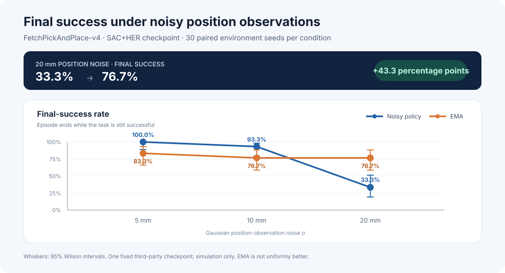
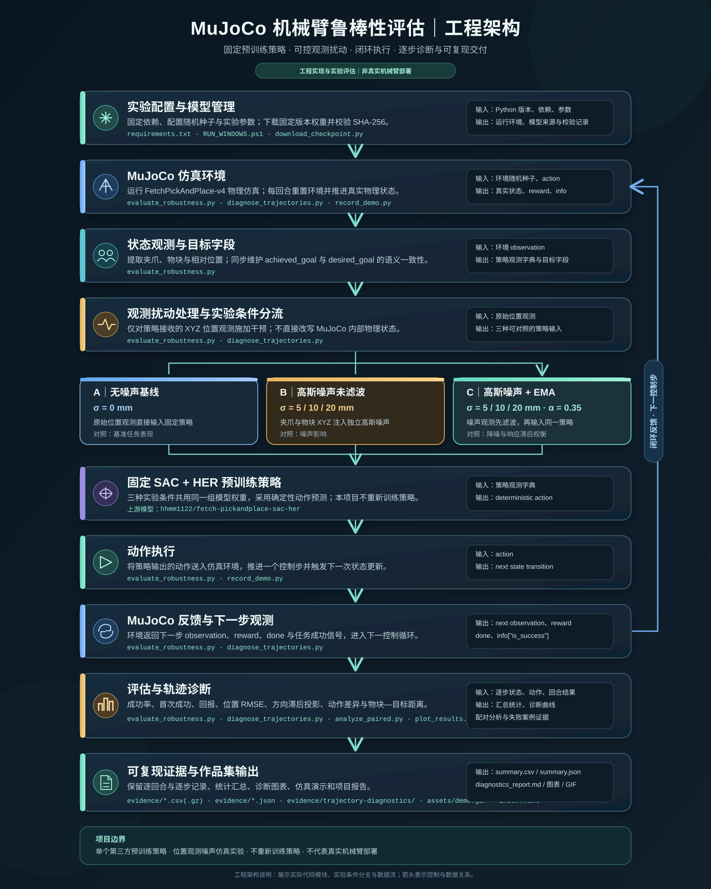
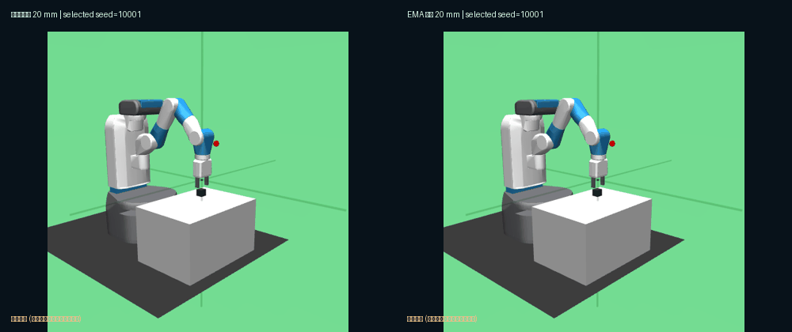

# 基于 SAC + HER 的机械臂抓放策略：位置观测噪声鲁棒性评估

**本项目在 MuJoCo 仿真中研究：高斯位置观测噪声与指数移动平均（EMA）滤波，会如何影响预训练 FetchPickAndPlace 机械臂抓放策略的表现。**

 

[独立评估报告](./EVAL30_REPORT_2026-11-01.md) · [演示核查报告](./DEMO_REPORT_2026-11-01.md) · [求职项目说明](./RESUME_CASE_STUDY.md) · [技术说明](./TECHNICAL_NOTES.md)

> **项目范围与成果归属：** 本项目没有重新训练 SAC+HER 策略，而是评估一个第三方预训练模型，并独立实现观测噪声注入、EMA 对照、配对随机种子评估、诊断指标、绘图、复现工作流与统计分析。下文所有结果均来自 MuJoCo 仿真，不代表真实机械臂实验。

---

## 核心结果

在 **20 mm 高斯位置观测噪声**下，EMA 滤波将终态成功率从 **33.3%（10/30）提高至 76.7%（23/30）**。但在 5 mm 和 10 mm 条件下，EMA 的终态成功率均下降 16.7 个百分点。因此，结果体现的是**依赖噪声水平的权衡**，而不是 EMA 在所有条件下都更好。

### 独立评估：每种条件使用 30 个环境随机种子

| 位置噪声标准差 | 未滤波策略：曾达成目标 / 终态成功 | EMA 策略：曾达成目标 / 终态成功 |
|---:|---:|---:|
| 0 mm（无噪声基线） | 100.0% / 100.0% | — |
| 5 mm | 100.0% / 100.0% | 90.0% / 83.3% |
| 10 mm | 100.0% / 93.3% | 96.7% / 76.7% |
| 20 mm | 80.0% / 33.3% | 86.7% / 76.7% |

- 独立评估共 **210 回合**：7 组条件 × 每组 30 个环境随机种子（10000–10029）。
- 预实验 35 回合与独立评估 210 回合合计 **245 回合**。两阶段使用不同的随机种子范围。
- **曾达成目标**：回合过程中至少有一步达到成功条件。**终态成功**：回合最后一步仍满足成功条件。两者不能互相替代。
- 在 20 mm 条件下，配对结果为：仅 EMA 成功 14 对、仅未滤波策略成功 1 对、双方均成功 9 对、双方均失败 6 对。探索性双侧精确 McNemar 检验 p = 0.0009766；未进行多重比较校正。
- Wilson 置信区间仍然较宽。例如，20 mm 条件下 EMA 的 23/30 终态成功率，其 95% Wilson 区间约为 59.1%–88.2%。

**结果解释：** EMA 可能抑制较大的测量波动，但滤波滞后也可能损害低噪声条件下的控制表现。我们已完成逐步轨迹诊断，记录并分析位置 RMSE、方向滞后投影、动作差异及物块—目标距离；这些结果支持进一步研究“降噪收益与响应滞后之间的权衡”，但尚不能证明滞后导致了性能变化，因果机制仍需独立干预实验验证。

## 本项目实现了什么

1. **观测扰动：** 分别对夹爪末端与物块的 XYZ 位置观测注入独立高斯噪声。
2. **目标字段一致性：** 根据受扰动后的物块位置重新计算相对位置，并同步更新 achieved_goal，避免目标条件策略通过未受扰动的坐标获得信息。desired_goal 保持不变。
3. **滤波对照：** 使用同一个固定策略、相同初始环境随机种子，对比未滤波观测与 EMA 滤波观测。
4. **评估指标：** 同时记录曾达成目标、终态成功、首次成功步数、回合回报和诊断距离。
5. **可复现证据：** 固定模型版本和 SHA-256，固定运行依赖，通过 GitHub Actions 执行测试与评估，并导出 CSV、JSON 和图表。
6. **配对分析：** 对相同初始环境随机种子的二元结果进行比较，并计算探索性精确 McNemar 检验。

## 工程架构图

图中按实际代码模块展示实验配置、MuJoCo 环境、观测处理、三种对照条件、固定策略、闭环执行、轨迹诊断与证据输出。三种条件共用同一固定 SAC+HER 预训练策略。

## 实验流程摘要

~~~mermaid
flowchart LR
    A[FetchPickAndPlace-v4 环境] --> B[位置观测]
    B --> C[无噪声基线]
    B --> D[注入 XYZ 高斯噪声]
    D --> E[未滤波输入]
    D --> F[EMA 滤波]
    C --> G[同一个 SAC+HER 预训练策略]
    E --> G
    F --> G
    G --> H[MuJoCo 执行动作并更新状态]
    H --> I[回合指标]
    I --> J[CSV、JSON 与置信区间]
~~~

## 仿真演示

我们为一个事先选定的对照案例生成了左右并排的 MuJoCo 仿真 GIF：随机种子 10001、位置噪声 20 mm。未滤波策略最终失败；EMA 策略在第 37 步首次成功，并在回合结束时仍然成功。

- [演示结果与渲染一致性核查报告](./DEMO_REPORT_2026-11-01.md)

- [查看 GIF](./assets/demo.gif) · [演示数据清单](./assets/demo.json) · [模型来源记录](./assets/model_provenance.json)
- 该 GIF 是**单个经过挑选的说明性案例**，不是随机抽样，也不代表总体成功率。总体表现应以以上 210 回合独立评估为准。
- GIF 由公开仓库中的[仿真演示工作流](./.github/workflows/demo.yml)生成；它不是实体机械臂录像。

独立 HTML 仪表盘源码位于 [index.html](./index.html)。目前可以下载后在浏览器本地打开；尚未配置 GitHub Pages 公网部署。

## 公开实验原始证据

本仓库归档了 30 个随机种子评估所使用的逐回合记录与汇总数据：

- [evidence/summary.csv](./evidence/summary.csv)：七组条件的精简汇总，可直接在 GitHub 中预览。
- [evidence/episodes.csv.gz](./evidence/episodes.csv.gz)：210 回合原始记录的 gzip 压缩文件。解压方法见[证据说明](./evidence/README.md)。
- [evidence/summary.json](./evidence/summary.json)：七组条件的完整汇总与置信区间。
- [evidence/model_provenance.json](./evidence/model_provenance.json)：上游模型版本与权重 SHA-256。
- [evidence/README.md](./evidence/README.md)：证据来源、字段说明与完整性校验方法。

公开的[自动化工作流页面](https://github.com/ELIMS-ECHO/mujoco-robustness-portfolio/actions)包含持续集成测试和复现任务。需要重新运行完整 30 种子评估时，使用 [evaluate.yml](./.github/workflows/evaluate.yml) 手动触发；这项任务比单元测试耗时得多。

## 个人贡献与上游成果边界

| 项目组成 | 成果归属 |
|---|---|
| SAC + HER 策略训练与模型权重 | [hhmm1122](https://huggingface.co/hhmm1122/fetch-pickandplace-sac-her) 提供的第三方模型，不是我的训练成果 |
| 观测噪声注入与目标字段一致性处理 | 本项目独立实现 |
| EMA 滤波与相同随机种子对照评估 | 本项目独立实现 |
| 回合指标、CSV/JSON 输出、置信区间与配对分析 | 本项目独立实现 |
| 绘图、回归测试、Windows 运行脚本与 GitHub Actions 工作流 | 本项目独立实现 |
| 真实机械臂部署或仿真到现实迁移 | 尚未完成 |

## 复现方法

### 环境要求

- Python 3.11
- MuJoCo 3.3.7
- Gymnasium 1.2.3 与 Gymnasium-Robotics 1.4.2
- Stable-Baselines3 2.8.0
- CPU 版本 PyTorch（按项目说明单独安装）
- NumPy 2.3.5
- Hugging Face Hub、Matplotlib、ImageIO 与 Pillow（用于模型下载、绘图和 GIF 录制）

### Windows 下的 PowerShell 运行方法

在项目目录中执行：

~~~powershell
conda create -n mujoco-portfolio python=3.11 -y
conda activate mujoco-portfolio

# 首次安装完整依赖，并运行冒烟测试：每组条件 5 个种子，共 35 回合
.\RUN_WINDOWS.ps1 -InstallDependencies -Episodes 5

# 冒烟测试通过后，可按正式评估的 30 个种子规模本机复核
.\RUN_WINDOWS.ps1 -Episodes 30 -SeedStart 10000
~~~

脚本会从 Hugging Face 下载固定版本的第三方模型，并记录 SHA-256；随后执行单元测试、MuJoCo 评估、图表生成和配对分析。它不会训练模型，也不会覆盖上游模型。Windows 本机运行尚未完成独立验收；已归档的 245 回合实验均在 GitHub Linux 运行器上执行。

### 正式评估设置

| 设置项 | 取值 |
|---|---|
| 仿真环境 | FetchPickAndPlace-v4 |
| 策略 | 一个固定的第三方 SAC+HER 预训练模型 |
| 动作预测 | 确定性预测 |
| 单回合最大步数 | 50 |
| 噪声类型 | 分别作用于夹爪与物块 XYZ 位置的独立高斯扰动 |
| 噪声标准差 | 5、10、20 mm |
| EMA 系数 | α = 0.35（固定，未使用正式评估种子调参） |
| 正式评估随机种子 | 10000–10029 |
| 条件 | 无噪声基线 + 5、10、20 mm 下的未滤波与 EMA 条件 |

## 仓库结构

~~~text
mujoco-robustness-portfolio/
├── README.md                  # 项目主页、成果归属与复现步骤
├── index.html                 # 响应式作品集网页与实验仪表盘
├── requirements.txt           # Python 依赖版本
├── assets/
│   ├── final-success-rate.svg # 终态成功率图
│   ├── demo.gif               # 仿真演示动图
│   ├── demo.json              # 演示案例数据
│   └── model_provenance.json  # 演示所用模型来源
├── evidence/
│   ├── episodes.csv.gz        # 210 回合原始记录
│   ├── summary.csv            # 精简实验汇总
│   ├── summary.json           # 完整实验汇总
│   └── model_provenance.json  # 实验模型来源
├── .github/workflows/
│   ├── tests.yml              # 自动化测试
│   ├── demo.yml               # 仿真演示生成
│   └── evaluate.yml           # 完整评估复现
├── evaluate_robustness.py     # 位置扰动、EMA、评估与统计
├── diagnose_trajectories.py   # 逐仿真步记录真实位置、观测误差、滤波滞后与动作
├── analyze_paired.py          # 配对随机种子与探索性统计
├── plot_results.py            # 根据真实汇总数据生成图表
├── record_demo.py             # 使用独立渲染环境录制演示
├── download_checkpoint.py     # 下载模型并核验 SHA-256
├── RUN_WINDOWS.ps1            # Windows 一键运行脚本
├── tests/                     # 自动化测试
├── EVAL30_REPORT_2026-11-01.md # 210 回合独立评估报告
├── PILOT_REPORT_2026-11-01.md  # 35 回合预实验报告
├── DEMO_REPORT_2026-11-01.md   # 仿真演示与一致性核查
├── RESUME_CASE_STUDY.md        # 求职项目说明
├── RESULTS_TEMPLATE.md         # 后续跨模型验证模板
└── TECHNICAL_NOTES.md          # 技术说明与项目记录
~~~

## 研究限制

- 目前只评估了一个固定的第三方预训练模型，不能据此推断跨模型或跨训练随机种子的泛化能力。
- 噪声采用理想化、相互独立的高斯 XYZ 位置误差。传感器偏置、时间相关误差、延迟、漂移、相机图像噪声和执行器扰动均不在本次实验范围内。
- 已完成逐步轨迹诊断，包括位置 RMSE、方向滞后投影、动作差异和物块—目标距离。诊断结果提示 EMA 存在噪声抑制与响应滞后的权衡，但尚未通过独立干预实验确认该机制与任务性能变化之间的因果关系。
- 失败分类属于启发式诊断，不是经过验证的物理抓取阶段标签。
- 本项目仅完成仿真实验，没有测试实体机器人、真实传感器或仿真到现实迁移。
- 30 个随机种子的评估属于工程实验，不构成广泛统计保证。配对检验为探索性分析，未进行多重比较校正。

## 模型来源与许可

本项目评估的模型来自 [hhmm1122/fetch-pickandplace-sac-her](https://huggingface.co/hhmm1122/fetch-pickandplace-sac-her)。

- 固定版本标识：c817f4a3033fb4bde985bfcfe93ed5d8b949b04b
- 权重 SHA-256：1aad52960bc0b7baaa5249f3aa1a2de09009c300dd2b0bf61c9c51d7467b017b
- 上游模型卡没有明确标注许可证。本仓库不重新分发模型权重；再次使用前应核实上游授权条款。
- 仿真环境为 [Gymnasium-Robotics FetchPickAndPlace](https://robotics.farama.org/envs/fetch/pick_and_place/)。

**核心结论：** 在当前固定模型与仿真条件下，EMA 在 20 mm 高噪声条件下表现更好，但在 5 mm 和 10 mm 条件下表现更差。项目贡献是实验设计、观测处理、评估分析和复现工程，不是第三方策略训练，也不是实体机器人部署。
